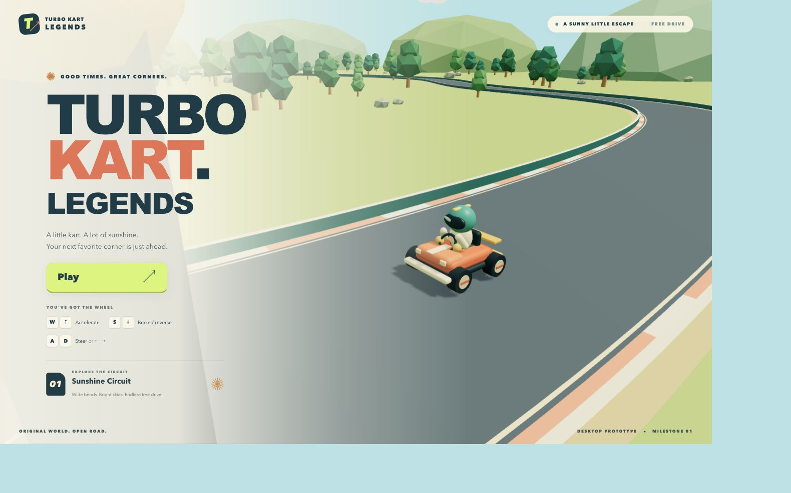
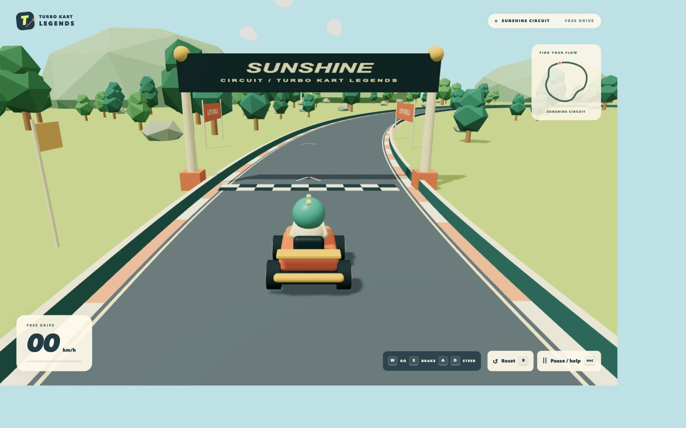

# Milestone 1 implementation and verification

Date: 2026-11-05. Scope: single-player, one kart, one closed track, free drive only.

## Delivered

- Vite/React/strict TypeScript app and reproducible npm lockfile; development, production preview, typecheck, lint, tests and build scripts.
- Original Sunshine Circuit, arc-length sampling, continuous road and curbs, solid corridor constraints derived from shared samples, and a distinctive start arch.
- Pure arcade controller with throttle, coast, brake/reverse, capped speeds, damped steering/slip, fixed 60 Hz stepping, bounded catch-up and interpolation.
- Circular kart boundary response with wall sliding, speed loss and out-of-bounds recovery. R and reset buttons restore spawn, motion and camera.
- Original procedural kart/driver, wheel animation, instanced trees/rocks, banners, clouds, sunny lighting and following shadow area.
- Delta-aware chase camera, start menu, speedometer, location map, pause/control guide, visible keyboard focus and dialog focus containment.
- Clear-input and pause requests on blur/hidden-document events, listener cleanup and no paused-time accumulation.

## Commands

- `npm install`: succeeded; final install reported zero vulnerabilities.
- `npm ci`: succeeded from the lockfile; zero vulnerabilities.
- `npm ls --depth=0`: resolved dependency tree, no invalid peer dependencies.
- `npm run dev`: started on 127.0.0.1:5173; HTTP 200 verified.
- `npm run typecheck`: passed.
- `npm run lint`: passed with zero warnings.
- `npm run test`: passed, 29 tests in 5 files after the steering follow-up.
- `npm run build`: passed with no chunk-size warnings; separate application, React, R3F, Three core and Three renderer chunks.
- `npm run preview`: started on 127.0.0.1:4173; HTTP 200 verified. Production menu, Play, arrow-key throttle, brake-to-reverse and Escape pause passed browser smoke testing; no console errors observed. Only the documented upstream Clock warning appeared on the production page.

Earlier iterations caught and fixed Vite 8 chunk configuration differences, dependency glob advisories, and the +Z steering handedness error. Long-circuit tests exceeded Vitest's default 5-second timeout under concurrent browser load; redundant projections were removed and the two integration fixtures have a 15-second budget. Other unit tests keep the default timeout. The final full suite completed in 2.32 seconds.

Local server binding and npm registry access required sandbox network escalation; both were available. Temporary QA servers are stopped at delivery.

## Browser interaction evidence

Executed in the Codex in-app browser:

- Start menu renders and Play enters an actual WebGL kart scene.
- Held W accelerates and changes position/speed. Arrow throttle also moves the kart.
- D plus throttle turns right after the handedness correction. Collision blocks escape at a rail; S backs away and the HUD displays REVERSE.
- R returns the map marker to exactly (-38, -103) and zero speed; reset button also works.
- Escape pauses at speed. Map position remained unchanged across separate observations while paused. Resume and reset inside the dialog work.
- Three Tab presses cycle back to Resume within the three-button pause dialog.
- Menu and gameplay layouts inspected in the normal narrow panel and a 1280 × 800 desktop viewport; no missing primary controls.

The automation browser did not reproduce normal blur/visibility events when switching or hiding its owned tabs. This was **not** counted as a focus-loss pass. The adapter's explicit blur/hidden events, pressed-key clearing and listener disposal pass unit tests. Manual OS window/tab switching remains required.

An uninterrupted human-driven full circuit was not completed in the browser. Two test-only steering fixtures complete the entire circuit in both directions through `KartInput` and assert containment. No AI system ships in the app.

## Remaining checks / limits

- Manually hold throttle while switching OS windows/tabs: verify auto-pause, release keys, return and resume without acceleration or a position jump.
- Drive a complete loop in each direction with a human; test sharp impacts, reverse steering and repeated reset.
- Check Chrome, Firefox and Safari on representative hardware; profile frame time and draw calls. DPR/shadow/instancing choices are budgets, not measurements.
- R3F's upstream Three.js Clock deprecation warning remains visible in the console. No warning suppression or dependency-source patches are used.
- No audio or future milestone systems are implemented.

Next logical work: finish that manual acceptance matrix and handling playtests, then move to Milestone 2.

## Screenshots

Captured from the production preview:

## Steering follow-up

The on-disk controller and wheel yaw signs were already correct when reversed controls were reported. A retained Simulation instance after React Fast Refresh was the suspected cause. App now accepts simulation, keyboard and track dependency updates by fully reloading the page. Editing a controller comment while paused was verified to return the browser to a fresh start menu.

Four additional regression cases feed A/D and Left/Right through the real keyboard adapter and movement controller. They project the result through a Three.js chase camera at five headings and check the actual screen direction. Browser driving from reset independently confirmed both key pairs: D/Right produced displacement to the kart's right, and A/Left produced displacement to its left. The full typecheck, lint, test and build sequence passed.
