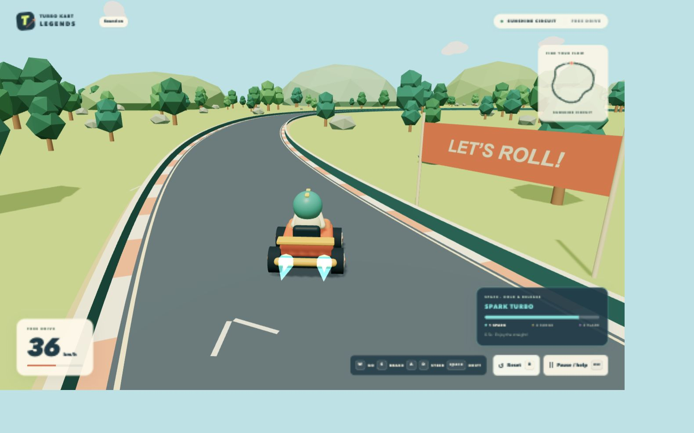

# Milestone 2 — Driving mastery

Date: 2026-11-05. The user's request to continue after M1/steering repair authorizes this phase. Historical M1 manual verification gaps remain in MILESTONE_1.md; they are not marked passed here.

## Implemented

- Required `drift` input shared by keyboard and standard gamepad adapters. Space is suppressed as a browser scroll key during driving, while focused UI buttons retain keyboard activation.
- Drift starts on a fresh Space press above 7.5 m/s with steering. A direction is locked for the slide; steering into it tightens the turn and countersteering widens it. Grip and lateral slip differ from normal driving without changing normal A/D/arrow direction.
- Three data-driven charge tiers: Spark (0.65 s), Surge (1.50 s), Flare (2.60 s). Releasing Space applies a capped timed boost; holding throttle accelerates toward the tier cap. Excess speed settles back to normal after expiry.
- Speed, steering, grounded contact, braking, rail impacts, pause and cooldown gates prevent stationary/wall farming or boost refresh spam. Reset restores all charge, boost, hop and event state.
- A ballistic drift-entry hop and landing compression/cue. Charge is suspended during the hop. The planar road corridor remains solid while airborne; no track ramp system was added.
- A 10 Hz charge/status HUD, tier-colored pooled sparks, exhaust flares, body slide pose and jump-aware camera. Geometry/material creation remains outside the frame loop.
- Original Web Audio skid, hop, landing and boost cues, unlocked by a UI gesture, with a Sound toggle. Gain changes are scheduled only when targets change, and finished one-shot nodes disconnect.
- Standard gamepad support: stick/D-pad, triggers, A/RB drift, Menu pause, View reset; deadzone, edge-triggered actions, neutral gating after pause/reset/connection, and pause on disconnect. Unknown layouts are ignored.
- Scope, README and in-game help updated. No dependencies, external assets, AI, race rules or backend were added.

## Automated checks

- Typecheck: passed.
- ESLint: passed with zero warnings.
- Vitest: 54 tests in 8 files passed. New cases cover all three boost tiers and limits, no stationary/reverse charge, a fresh-press requirement, hop/landing, grounded-only charge, countersteering, charge/boost cancellation, no recharge during an active boost, airborne barriers, pause/reset, and identical results at 30/60/144 render FPS. Gamepad and audio lifecycle tests use injected snapshots/mocks.
- Production build: passed again after disk space was restored, with no chunk-size warnings. `git diff --check` passed.
- Development startup/cache recovery: a fresh `npm run dev` on 127.0.0.1:5173 loaded the updated menu and controls in the browser after the disk cleanup. Temporary QA servers were stopped at delivery; normal startup is unchanged.
- Earlier M1 steering/track traversal tests remain passing.

The Mac's disk filled during work. A new test could not be created, and a rebuild later failed with `ENOSPC` while copying a user-supplied public GLB. Only the generated Vite dependency cache was removed to recover working space. The user freed disk space; final validation is rerun afterward. User assets are preserved.

## Browser checks

Executed in the in-app browser against an isolated local QA server:

- Play, existing acceleration and reset controls worked after integrating drift input.
- At forward speed, Space + D entered a drift/hop. The HUD showed BUILDING CHARGE with zero charge while airborne, then SPARK TURBO on release with its remaining duration.
- Menu exposes Space; the HUD explains the 27 km/h entry speed and all three tiers.
- The rebuilt production preview passed the same hop/charge/Spark release sequence, with both tier-colored exhaust flares captured in the screenshot below.
- Sound on/off toggled in both gameplay and pause. Tab from the last pause control wrapped to Resume. Reset in pause and resume returned to zero speed and zero charge.
- Narrow and 1280 × 800 desktop layouts were inspected; the charge HUD stays clear of the kart. The production console showed no errors; only the existing upstream Clock deprecation warning remained.

## Manual verification still needed

- Human tuning of longer drifts and tiers 2/3 around the actual circuit. These tiers pass pure-controller tests; no full human drift circuit or full browser tier-3 demonstration is claimed.
- Physical gamepad, audio listening/volume balance, real OS focus-loss behavior, and the Chrome/Firefox/Safari performance matrix.
- The upstream R3F/Three.js Clock deprecation warning remains unsuppressed.

Next: finish the manual checks, tune grip/charge thresholds, then proceed to M3 checkpoints/laps/racing/AI.
